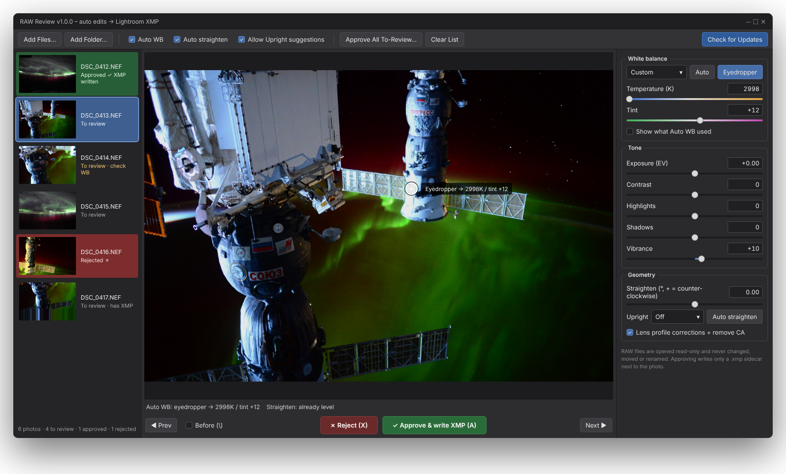
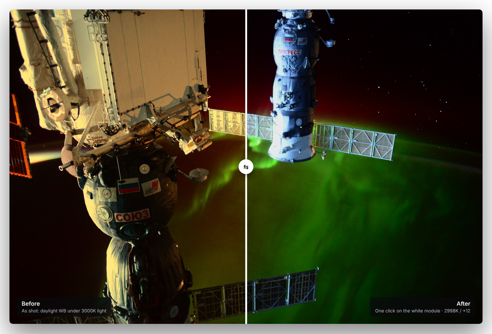

# RAW Review

**Batch auto-edit RAW photos, review each one, and send the approved edits to Lightroom without ever touching the RAW files.**

RAW Review analyzes every photo you drop into it and proposes an edit: white balance, straighten,
exposure, levels, contrast, colour, sharpening and noise reduction. You flip through them, **approve** (`A`),
**tweak** with sliders, or **reject** (`X`). Approved edits are saved as standard Lightroom
`.xmp` sidecar files, so Lightroom Classic picks them up as normal, fully editable sliders.

**[⬇ Download the latest release](https://github.com/kefirman9000/raw-review/releases/latest)** · [ZIP of main](https://github.com/kefirman9000/raw-review/archive/refs/heads/main.zip) · [What's new](CHANGELOG.md)

Interface illustration and before/after rendered with RAW Review's own colour engine. Photo: NASA, International
Space Station (public domain). A tungsten-light cast was simulated, then removed with one eyedropper click (2998K / +12; the true cast was 3000K / +12).

## Features

- **Edit many photos at once:** *Edits apply to → Selected / Checked photos* copies each slider change to them, either the exact value or as a relative nudge.
- **Grid view** (`G`) to see the whole shoot at a glance.
- **Cull suggestions:** flags photos that look soft, have blown highlights or are very dark, and the weaker frames of bursts and near-duplicates (the sharpest frame, ★, is kept). Check them to look them over, or reject them in one go.
- **Automatic sky and subject masks**, written as Lightroom's own Select Sky / Select Subject (Lightroom computes the exact mask).
- **Per-photo Undo / Redo** (`Ctrl+Z` / `Ctrl+Y`).
- **Starts from your existing Lightroom edits** when a photo already has them, and keeps your own Lightroom crop and masks.
- **Star ratings and colour labels**, written to Lightroom on approve.
- **Remembers your settings and the photos you had open**, even across updates.
- **My auto settings:** make auto edits brighter or moodier, punchier or softer, and set rules like *Sharpening always 60* or *never touch white balance*. Every new photo follows them.
- **Hold-to-compare and split view**, finer sliders, **undo approval**, find by name, analysis progress with pause, foldable panels and interface sizing.
- **Drag and drop** photos or whole folders (subfolders included).
- **Smart auto white balance**
  - Looks for the surfaces most likely to be truly neutral: the brightest unclipped *near-whites* and the darkest *near-blacks*.
  - Skips clipped highlights and textured areas, and cross-checks the whites against the blacks.
  - Rejects physically implausible light, so a blue shirt under tungsten won't fool it.
  - Low-confidence results are flagged **"check WB"**, and you can show exactly which spots it used.
- **Eyedropper** WB: click anything that should be white, grey or black.
- **Straighten modes:** Off · Auto (best guess) · Horizon (rotate) · Verticals (rotate) · Lightroom **Upright: Level / Vertical / Auto / Full** (Full = architecture).
- **Auto selected photos:** select photos, then *⚡ Auto selected…* (Ctrl+Shift+E) or right-click to run chosen auto tools with their own options on just those photos.
- **Subject crop (optional):** a minimal, same-aspect crop that centres the main subject (planes, cars…). Turn it on in *Auto options*, or per photo under *Geometry*.
- **Auto tone, each one separate:** exposure, levels (blacks & whites), shadows & highlights, contrast, colour (vibrance & saturation). Aims for a normal-looking photo; strength and an exposure bias are adjustable under *Auto options*.
- **Auto sharpening and noise reduction**, from noise and softness measured on the full-resolution image.
- **Check boxes per photo** plus **Batch edit…**: run any auto tool, or increase / decrease / set / reset any setting, on this photo, the selected ones, the checked ones or all. *Undo batch* reverts the last one.
- **Auto-write Lightroom XMP** option: writes each sidecar as soon as a photo is analysed.
- **DNG colour profiles:** colours come from the colour matrices and embedded profile inside the DNG (dual-illuminant matrices, forward matrices, hue/sat map, look table, tone curve, baseline exposure), so files like Google Pixel DNGs render with correct colour. Pixel's local HDR tone map (`ProfileGainTableMap`) and lens shading are applied too, so the preview matches the camera's own rendering. Adjust under *Auto options -> Camera profile (DNG colour)*.
- **RAW and DNG** are both supported. Lightroom ignores sidecars for DNG, so for DNG an *edited copy* is exported as `name.dng` into a `RAW Review export` folder next to the original (settings embedded in its XMP packet, image data untouched). The original DNG is never modified and no `.original` files are made. Import that folder into Lightroom.
- **Sliders:** Temperature, Tint, Exposure, Contrast, Highlights, Shadows, Whites, Blacks, Vibrance, Saturation, Sharpening (amount, radius, detail, masking), Noise reduction (luminance, detail, color), Straighten, and lens profile corrections.
- **Hold-to-compare and split before/after**, copy/paste settings to many photos, and "Approve all".
- Temperature/Tint use the same conversion as Adobe's DNG SDK, so the numbers line up with Lightroom's sliders.

## Your RAW files are never touched

- RAWs are **opened read-only**. Nothing is ever written to them, and they are never moved, renamed or deleted.
- The only file written is `photo.xmp` next to `photo.CR3` (Lightroom's normal sidecar).
- An existing sidecar is backed up once as `photo.xmp.bak`. Only the settings this app controls are changed; ratings, keywords, Clarity, masks etc. are kept.
- Every write checks the RAW's size and timestamp before and after, and refuses any filename that looks like a photo (RAW/DNG/JPG/TIFF…).
- Automated [safety tests](tests/test_safety.py) check all of this on every change, and a release isn't published unless they pass.

## Install (Windows)

1. Download **`RAW_Review-Windows-v….zip`** from the [latest release](https://github.com/kefirman9000/raw-review/releases/latest).
2. Unzip it anywhere and run **RAW Review.exe** in the **RAW Review** folder. No Python needed.
3. If a blue *Windows protected your PC* box appears, click **More info → Run anyway**.

**From source** (any system): install **Python 3.12**, download `RAW_Review-v….zip` (or *Code → Download ZIP*), then double-click **`RAW Review.bat`** on Windows (the first run sets up its own environment), or `pip install -r requirements.txt` and `python raw_review_app.py` elsewhere.

## Keys

| Key | Action |
|---|---|
| `A` | Approve: write the XMP, go to the next unreviewed photo |
| `X` | Reject: nothing is written |
| `←` `→` | Previous / next photo |
| hold `\` | Show the original while held (tick *Split* for a draggable before/after) |
| `W` | Re-run auto WB |
| `E` | Auto-enhance this photo (all ticked auto tools) |
| `C` | Check / uncheck this photo |
| `G` | Grid view on / off (double-click or `Enter` opens a photo; with several selected, `A` / `X` act on all of them) |
| `Ctrl+Z` / `Ctrl+Y` | Undo / redo the last change to this photo (each photo has its own history) |
| `1`–`5` / `0` | Star rating / clear (several selected photos at once) |
| `6` `7` `8` `9` | Red / yellow / green / blue label (press again to clear) |
| `Ctrl+F` | Find a photo by name |
| `?` / `F1` | All shortcuts and tips |
| `Ctrl+C` / `Ctrl+V` | Copy settings / paste to the photos selected in the list |

## Getting the edits into Lightroom Classic

- **New photos:** just import them. Lightroom reads the sidecars automatically.
- **Photos already in your catalog:** select them, then *Metadata → Read Metadata from Files*.
- If *Automatically write changes into XMP* is on in Lightroom, it can overwrite sidecars with its own edits. Read the metadata in first.

## Updating

New versions are published automatically as [GitHub Releases](https://github.com/kefirman9000/raw-review/releases) whenever the version number changes.

Click **Check for Updates** in the toolbar. The app also checks quietly at startup and shows an
**⬆ Update** button when a newer version is on GitHub (a published Release or the main branch, whichever is newer).
Nothing is installed until you click *Install & Restart*. The Windows program checks the download against the fingerprint published with the release and copies it in when it restarts; the source version keeps the previous one in `.update_backup/`.
The updater only replaces the app's own files and never looks at your photos.

## Good to know

- **Settings and the last session** are stored in a `.raw_review` folder in your user folder (`C:\Users\<you>\.raw_review` on Windows). Delete it to start completely fresh.

- **Sky / subject masks:** Lightroom computes them itself. If it shows a warning on a mask, select the photos and use *Update AI Settings*. If a sky's exposure looks 4× too strong or weak in Lightroom, change `LOCAL_EXPOSURE_SCALE` at the top of `raw_review_core.py`.

- The preview approximates Lightroom's rendering. What counts is the values written to the sidecar.
- **Pixel DNGs:** the preview applies the DNG's local HDR tone map (`ProfileGainTableMap`) and lens shading, so it matches Google's own rendering. The tone map stays inside the DNG (only the XMP packet is ever rewritten), and Lightroom reads it from there. I could not test that in Lightroom itself. If a Pixel photo looks *darker in Lightroom than in the preview*, your Lightroom isn't applying the table: turn off *Auto options -> Camera profile -> Pixel local HDR tone map*, and the auto tools will brighten with Exposure and Shadows instead (a close approximation, not identical).
- Not applied: the DNG's geometric lens-distortion opcodes (ultrawide Pixel shots keep their distortion in the preview; Lightroom's lens profile corrects it) and the newer `ProfileGainTableMap2` layout.
- `TARGET_KEY_HDR` in `raw_review_auto.py` sets how bright Auto exposure aims for files with a tone map. It is calibrated on two Pixel 7 Pro files; use *Exposure bias* if yours run consistently lighter or darker.
- Upright is calculated by Lightroom itself, so it isn't shown in the preview.
- Sharpening and noise reduction are written to Lightroom but not shown in the preview. Their auto values come from measurements that were tuned by estimate, so check a few photos at 100% in Lightroom and use *Auto strength* to adjust.
- Auto exposure assumes Lightroom adds about +0.5 EV before your Exposure slider (`PREVIEW_BASE_EV` in `raw_review_core.py`). If photos come out consistently too bright or dark in Lightroom, use *Auto options → Exposure bias*.
- Only settings you or an auto tool have set (whites, blacks, saturation, sharpening, noise) are written, so an existing sidecar's values are left alone otherwise.
- If straightened photos tilt the wrong way in Lightroom, change `XMP_ANGLE_SIGN` at the top of `raw_review_core.py`.

## Built with

[rawpy](https://github.com/letmaik/rawpy) / LibRaw (read-only RAW decoding), NumPy, OpenCV, PySide6.

## Support

RAW Review is free. If it saves you editing time, you can support development through
**[GitHub Sponsors](https://github.com/sponsors/kefirman9000)**. Thank you!

## License and disclaimer

Copyright © 2026 kefirman9000. All rights reserved. RAW Review is free to use; see [LICENSE](LICENSE) for what is and isn't allowed.

- **Back up your photos.** RAW Review only reads your RAW files and never changes them, but always keep backups of anything you can't replace.
- Auto edits are suggestions. Check each photo before you rely on it.

RAW Review is provided **as is**, without warranty of any kind. Use it at your own risk; the author is not liable for any damage, data loss or other loss arising from its use.

RAW Review is an independent project and is not affiliated with, endorsed by or sponsored by any of the companies or products named here. Adobe, Lightroom and Photoshop are trademarks of Adobe Inc. Google and Pixel are trademarks of Google LLC.

Found a security problem? Please report it privately; see [SECURITY.md](SECURITY.md).
